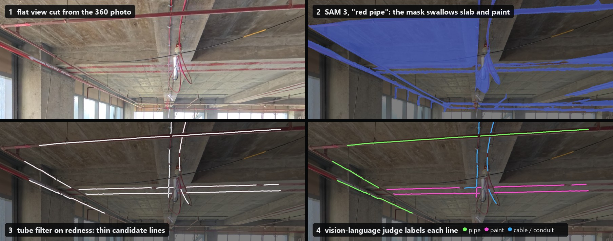
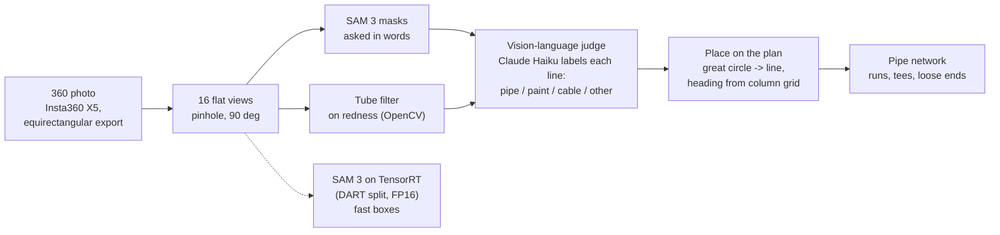
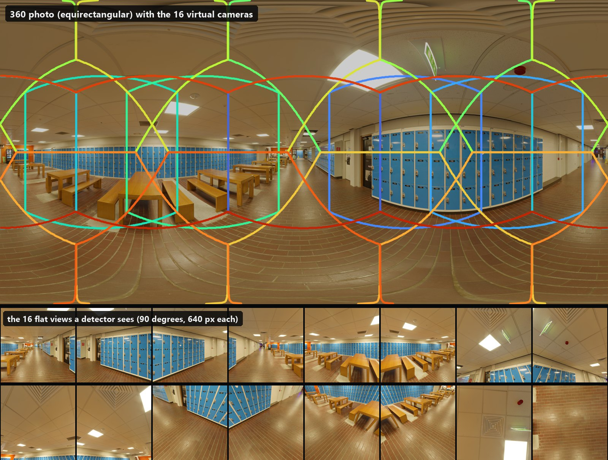
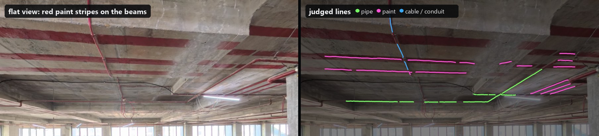
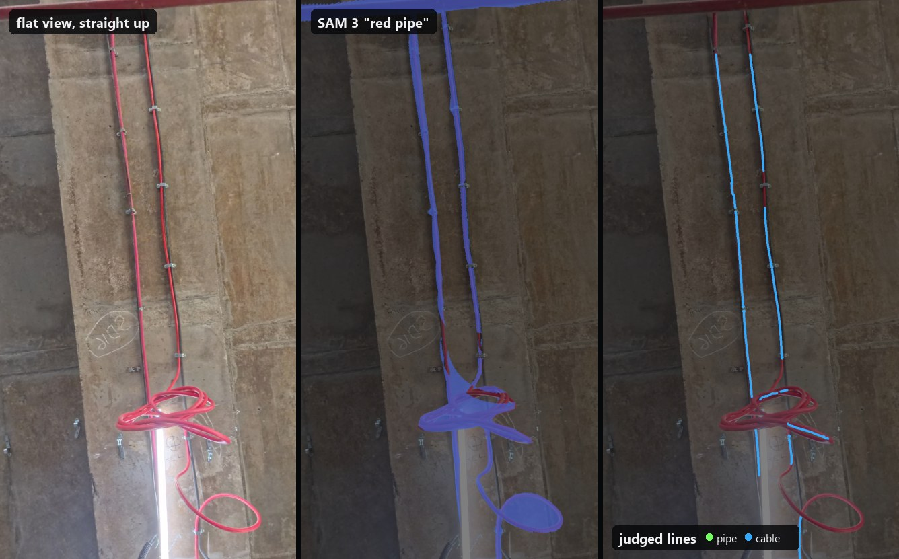
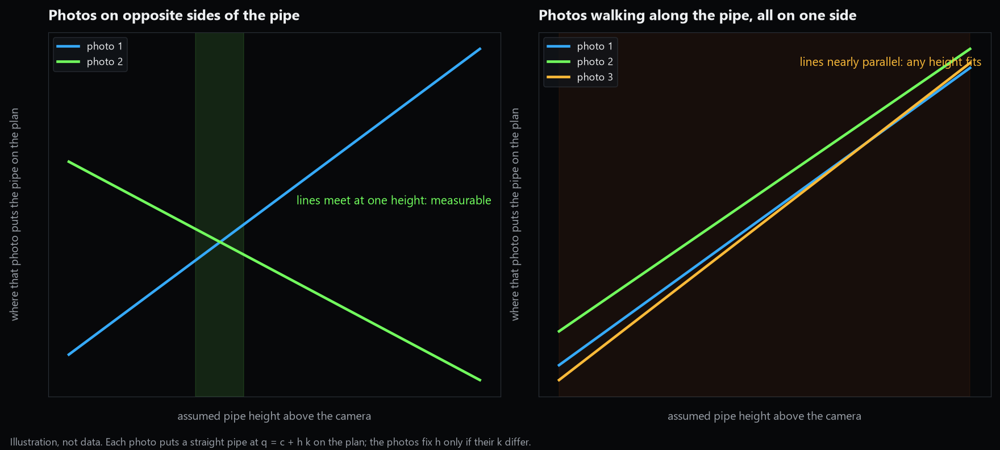

# Finding fire sprinkler pipe in 360° photos of a fit-out site

Untrained vision models, a classical line filter and a cheap vision-language
judge, turning 360° photos of a bare office floor into the fire sprinkler pipe
drawn on the floor plan.



*One flat view cut from a 360° photo. SAM 3, asked for "red pipe", returns one
mask over the slab, the painted stripes and the pipes together (2). A tube
filter on redness draws thin candidate lines instead (3), and a
vision-language model labels each one (4): green pipe, magenta paint, blue
cable.*

B.Tech project, Civil Engineering, IIT Bombay (2026), supervised by
Prof. Varun Kumar Reja and done with an industry partner. Solo work.

## The problem

On an interior fit-out, the services go in before the ceiling closes:
sprinkler pipe, electrical conduit, ducts. Progress is checked by walking the
floor and comparing what is installed against the drawings, and the record is
a folder of ad-hoc phone photos that nobody can compare across visits.

A 360° camera records the whole floor in one walk. The hard part is reading
the photos: no public model is trained on bare fit-out ceilings, the
equirectangular image distorts everything near the top, and on this site the
concrete beams carry broad red painted bands that look exactly like red fire
pipe in a small window.

## The pipeline



1. **Capture.** An Insta360 X5 on a walk through the floor. Its raw `.insp`
   files are two fisheye circles, so photos are exported as equirectangular
   JPEGs first. The X5 writes no compass heading into its photos (the raw file
   holds an accelerometer log and no usable gyro or magnetometer data), so each
   photo's position and heading on the plan are pinned by hand.
2. **Flat views.** A detector trained on ordinary photos cannot read an
   unrolled sphere: straight pipes bend and the ceiling smears across the
   width. Each panorama is resampled into 16 pinhole views (8 on the horizon,
   rings above and below, one straight up and one down), and every result is
   mapped back to directions on the sphere
   ([`projection.py`](src/vision/projection.py)). Masks from overlapping views
   are stitched on a canvas as sharp as the views, compared only where both
   views can see ([`stitch.py`](src/vision/stitch.py)). A **second look**
   re-cuts views centred on each pipe and past its loose ends
   ([`second_look.py`](src/vision/second_look.py)).
   
3. **Candidates.** Two sources:
   - **SAM 3** asked in words ([`concept.py`](src/vision/concept.py)), with
     site wording chosen by experiment ("red pipe", "black pipe",
     "silver duct": [`concepts.py`](src/vision/concepts.py)) and a pipe-thin
     check that drops masks too wide to be pipe.
   - **A tube filter on redness** ([`tube_filter.py`](research/tube_filter.py)):
     the Hessian vesselness filter used for blood vessels (Frangi et al. 1998),
     run on the Lab a* channel of five 100° views, thinned to one-pixel crest
     lines. No model, and its lines are where the pipe is to the pixel.
4. **Judge.** Each connected piece of tube-filter line becomes a numbered
   candidate drawn on its view. A vision-language model (Claude Haiku) labels
   every candidate pipe, paint, cable or other
   ([`vision_judge.py`](research/vision_judge.py)). The filter keeps the
   geometry exact; the model only says *what* each line is.
5. **Plan.** A straight horizontal pipe seen from one point lies on a great
   circle of the sphere. Its direction on the plan needs no distance; its
   sideways offset is `h / tan(latitude)`, where `h` is the pipe's height above
   the camera ([`pipe_layout.py`](research/pipe_layout.py)). Each photo's
   heading is corrected by squaring its pipes to the building's column grid
   ([`trace_calibration.py`](research/trace_calibration.py)).
6. **Network.** Lines from all photos are merged into runs and cut at
   junctions into tees, elbows, crossings and loose ends, the form a sprinkler
   drawing is sized and billed in
   ([`pipe_schematic.py`](research/pipe_schematic.py),
   [`pipe_network.py`](research/pipe_network.py),
   [`judge_layout.py`](research/judge_layout.py)).

**Other models wired in behind the same provider interface**
([`detect.py`](src/vision/detect.py), [`catalogue.py`](src/vision/catalogue.py)):
Grounded SAM 2 (Grounding DINO boxes + SAM 2.1 masks), YOLO11 (COCO),
YOLO-World v2 for open-vocabulary boxes, and a public YOLOv8 PPE model. In the
research scripts: SAM 2.1 prompted with tube-filter lines, CLIP as a paint
classifier, Depth Anything V2 for pipe height, and Qwen3-VL as an offline
judge. What each of those taught me is below.

### SAM 3 on TensorRT

SAM 3 through PyTorch runs one forward pass per phrase per view, which made a
16-view panorama slow. Following DART (Turkcan 2026,
[arXiv 2603.11441](https://arxiv.org/abs/2603.11441)), the same checkpoint is
exported through ONNX into two TensorRT FP16 engines, the ViT-H backbone and
the encoder-decoder with its scoring head, with the text features cached per
phrase ([`build_dart_engines.ps1`](scripts/build_dart_engines.ps1),
[`build_support.py`](scripts/dart/build_support.py),
[`sam3_trt.py`](src/vision/sam3_trt.py)). The backbone of the next view runs
on one CUDA stream while the encoder-decoder of the current view runs on
another.

On an RTX 4070 laptop GPU this was **17× faster per photo** with warm engines,
and **14.5× faster end to end** over a walk once view rendering was moved to a
prefetch thread, with matching scores on my test set. It returns boxes only
(DART's speed comes from skipping the mask decoder), so the pipe work still
uses the PyTorch SAM 3 for masks.

## What I did

I built this alone over a semester, from capture to plan:

- Captured the site with the 360 camera, and worked out what the camera's
  files actually contain before trusting them (experiment 00).
- Wrote the projection layer, the mask stitching and the second look, and
  measured each against the previous version on the site photos.
- Wired SAM 3, Grounded SAM 2, YOLO11, YOLO-World v2 and a PPE model behind
  one interface so they could be compared on the same photos.
- Integrated DART's TensorRT split of SAM 3: a separate Python 3.12
  environment for the export (DART pins `numpy<2` and an older torch), one
  pinned TensorRT runtime shared by both environments, the presence head
  exported so scores keep their meaning, and a phrase-keyed text cache so new
  prompts cost one encoding.
- Traced the fire pipe by hand on a few photos to have something to score
  against, then ran numbered experiments, each with a question, setup, rerun
  command, result and what it does not show.
- Wrote the tube filter, the paint filters, the judge's candidate sheets, the
  back-projection onto the plan and the pipe network.

## What I learned

**A box is the wrong shape for a pipe.** A box around a diagonal run of pipe
is mostly ceiling, and boxes from neighbouring views never agree. Masks trace
the pipe (experiment 01).

**Pipes leave the frame.** Most pipe masks touch the edge of their view, so
the pieces have to be joined on the sphere. Comparing two views' masks only
where both can see, on a canvas as sharp as the views, is what made a pipe
crossing a view edge come back as one pipe (experiments 02, 03). Re-cutting
views centred on each pipe found more pipe; simply rendering sharper views did
not (experiment 06).

**The words decide what an untrained model finds.** "Fire sprinkler pipe"
landed on black conduit as often as on red pipe. Colour words ("red pipe",
"black pipe", "silver duct") separated the services on this site (experiment
05). That vocabulary belongs to this site's colours; another site needs its own.

**SAM 3 finds the pipe but not its edge.** Its "red pipe" masks spread over
the painted bands and the slab between two runs (the figure at the top). A
width rule removed the broad bands, but thin paint stripes survived it
(experiments 05, 11).

**A filter from medical imaging drew better pipe lines than SAM 3.** The tube
filter on redness, with no model at all, scored better against my hand traces
than SAM 3's outlines did (experiment 13). It still marks thin red paint
stripes, because in a small window a stripe and a pipe look the same.

**Telling paint from pipe needs the scene, not the pixels.** I tried a colour
rule, a small decision tree on shading and shadow features, and CLIP with
words and with a trained probe. Only the colour rule worked, and only for the
broad flat bands (experiment 12). Masks from SAM 2.1, prompted with the tube
filter's lines, gave clean pipe-shaped outlines, but outlined paint and conduit
as faithfully as pipe (experiment 18).



**A cheap vision-language judge was enough, if it only labels.** A person
tells a stripe from a pipe by shading across a cylinder, hanger rods, and the
stripe stopping at the beam's edge. With the tube filter proposing exact lines
and the model only naming them, Claude Haiku, Sonnet and Opus agreed with each
other on **85–89%** of the same candidates, so the smallest is enough. Local
Qwen3-VL 4B and 8B agreed with them on only **51–56%** and missed most paint
(experiment 20).

**Ground truth is itself uncertain.** Thin red lines clipped flat to the beams
turned out to be disputed: the judge calls them cable, and my own hand traces
had counted them as pipe. Some of the "errors" were in my answer key
(experiment 20).



**The camera does not know which way it faces.** The X5's photos carry no
heading. Pinned by hand, headings were visibly off; the pipes themselves,
squared to the column grid, correct them (experiment 15).

**The pipe's height sets every length, and this walk cannot measure it
(experiment 17).** A pipe seen from one photo lands on the plan at an offset
proportional to its assumed height above the camera, so the total length
scales with that height. Two photos fix the height only if they see the pipe
from different sides. The walk followed the pipes, so nearly every pipe was
seen from one side, and the photos agree with almost any height.



**A single-image depth model did not rescue it.** Depth Anything V2 (metric,
indoor) gave per-photo heights whose scale changed with the field of view it
was shown and from view to view, so it would add error rather than remove it
(experiment 19). The height has to be measured on site.

**Speed moves the bottleneck.** After the TensorRT engines, rendering the flat
views took most of the time until it ran on its own thread. And the fast path
returns boxes, which is why the masks still come from PyTorch.

## Status and next steps

The chain runs end to end on one real walk: photos to judged lines to a pipe
network on the plan. Not yet done:

- **Pipe heights, measured.** A laser measurement to a few pipes and the slab,
  and photos taken from both sides of a pipe, so the photos can be checked
  against measured lengths instead of an assumed height.
- **The pipe network.** Telling a cross fitting from one pipe passing under
  another, joining the network across gaps, and comparing it with the
  services drawing.
- **Progress over time.** The same floor on two dates, and what changed.
- **A labelled set.** Corrected hand traces (conduit marked as its own
  system) to score every step honestly, and later to train on.

## What is in this repository

| Path | What |
| --- | --- |
| [`src/vision/`](src/vision/) | Projection, stitching, second look, the provider interface, SAM 3 / Grounded SAM 2 / YOLO / YOLO-World providers, SAM 3 on TensorRT |
| [`scripts/`](scripts/) | The DART TensorRT engine build (Windows PowerShell) and its helper |
| [`research/`](research/) | The fire-pipe research scripts: tube filter, paint filter, judge sheets, layout on the plan, pipe network, height test |
| [`demo/cut_panorama.py`](demo/cut_panorama.py) | Runs on any 2:1 panorama: cuts it into the 16 flat views |
| [`docs/figures/`](docs/figures/) | The figures in this README |

This is a selection from a larger private project. The capture platform (web
app, database, job queue), the site photos and the drawings are not public, so
the research scripts are shown as they were run and need inputs that are not
included. The demo runs on its own:

```bash
pip install numpy pillow
python demo/cut_panorama.py my_panorama.jpg views/
```

The detectors need PyTorch, `transformers`, `ultralytics` and, for the fast
path, TensorRT with an NVIDIA GPU. SAM 3's weights are gated on Hugging Face
and need Meta's licence accepted first.

## Credits

SAM 3 and SAM 2.1 (Meta), DART (Turkcan 2026), Grounding DINO, Ultralytics
YOLO11 and YOLO-World, Depth Anything V2, CLIP, Qwen3-VL and Claude Haiku.
The panorama in the views figure is from [Poly Haven](https://polyhaven.com)
(CC0).

## Licence

Code: [MIT](LICENSE). Model weights keep their own licences (SAM 3 is under
Meta's SAM licence).
